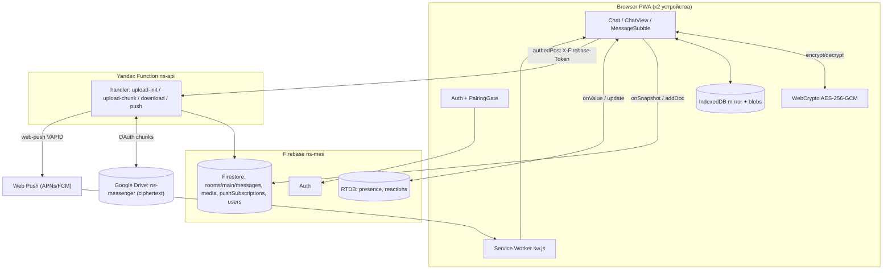
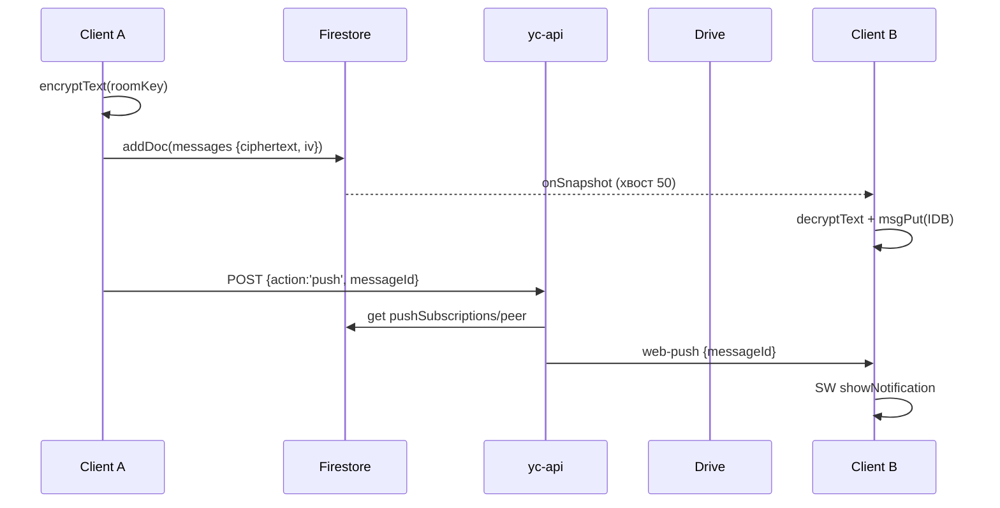

# Архитектура проекта `ns` — приватный E2EE-мессенджер для двоих (Cuddle)

> Назначение файла: отдать другой LLM как ТЗ для отрисовки архитектурной схемы приложения.
> Проект: React PWA-чат со сквозным шифрованием, только 2 пользователя (`ALLOWED_UIDS`), одна комната `rooms/main`.

## 1. Краткое описание

- Приватный мессенджер: текст + фото + голосовые + реакции + ответы (reply) + spark-салюты.
- Сквозное шифрование AES-256-GCM (WebCrypto). Plaintext никогда не покидает устройство. Сервер/Drive/Firestore видят только шифротекст + открытую метадату.
- Общий `room key` (`ns1.…`) создаётся на 1-м устройстве, переносится на 2-е через QR/код/камеру, хранится в `idb-keyval` (`ns-room-key-main-v1`), на сервер не отправляется.
- Бэкенд — одна Yandex Cloud Function `ns-api` (`yc-api/index.js`). Фронт всегда ходит в неё (`VITE_API_BASE_URL`). Каталог `api/` — legacy Vercel, не используется.
- Данные: Firestore (сообщения), Realtime Database (presence/typing/seen/reactions), Google Drive (шифрованные медиа-байты), IndexedDB (локальное зеркало + кэш блобов), localStorage (настройки, peerUid-кэш).
- Push: Web Push через Service Worker `public/sw.js` + VAPID. Payload — только `{messageId, senderId, ts}`, без текста.
- PWA offline-shell: `vite-plugin-pwa` (`injectManifest`), прекэш статики, runtime-кэша API нет.

## 2. Технологический стек

| Слой | Технологии |
|---|---|
| Frontend | React 19 + TypeScript, Vite (`base: './'`), `react-router` нет (роутинг: `/` → App, `/test` → Preview), `lucide-react`, `qrcode.react` |
| Crypto | WebCrypto AES-GCM-256, `src/lib/crypto.ts`, `src/lib/keystore.ts` (`idb-keyval`) |
| Client storage | IndexedDB `ns-msgs-v1` (MSG_STORE + REACT_STORE + META_STORE) и `ns-media-v1` (BLOB_STORE + META_STORE), localStorage (`ns-settings-v1`, `ns-peer-uid`) |
| Firebase client | `firebase@13`: Auth (email/password, `browserLocalPersistence`), Firestore (`persistentLocalCache`, `experimentalAutoDetectLongPolling`), RTDB |
| Backend | Yandex Cloud Function Node 22 `yc-api/`: `googleapis`, `web-push`, `jsonwebtoken` (проверка Firebase ID token). Entry: `module.exports.handler` |
| Media storage | Google Drive (личный OAuth `GOOGLE_OAUTH_*`, папка `ns-messenger` / `DRIVE_FOLDER_ID`, scope `drive.file`), resumable upload чанками 1МБ |
| Push | `web-push` (VAPID), Firestore `pushSubscriptions/{uid}`, SW `public/sw.js` (Workbox precache, `push`/`notificationclick`) |
| PWA | `vite-plugin-pwa`, `public/manifest.webmanifest` (name `Cuddle`), иконки `icon-*.png` |
| Правила доступа | `firestore.rules`, `database.rules.json`, `ALLOWED_UIDS` (2 UID захардкожены) |
| Деплой | Фронт: статика (Vercel + GH Pages, `vercel.json` rewrite → `/index.html`); Бэкенд: `yc-api/deploy.sh` |

## 3. Структура репозитория

```
src/
  main.tsx                 # entry, /test → Preview, иначе App
  App.tsx                  # Shell: AuthProvider → Login | PairingGate | Chat + QR-модалка ключа
  types.ts                 # ChatMessage, MessageDoc, MediaDoc, ReplyTarget
  components/
    Login.tsx              # email+password → lib/auth.signIn
    PairingGate.tsx        # create/show/enter/scan room key (BarcodeDetector)
    Chat.tsx               # боевой контейнер: useChat+useMedia+usePresence, push toggle, обои/аватар, debug
    ChatView.tsx           # презентация ленты
    MessageBubble.tsx      # пузырь + useMessageReactions
    SettingsSheet.tsx      # настройки
    SparkOverlay.tsx       # анимация spark
  hooks/
    useChat.ts             # текст: onSnapshot хвост 50 + IDB boot 200 + loadOlder 60, sendText, firePush
    useMedia.ts            # фото/голос: prepare → encrypt → upload-init/chunk → media+message docs, очередь скачивания x4
    usePresence.ts         # RTDB presence/{uid}, typing, seenTs, поиск пира через users/
    useReactions.ts        # RTDB reactions/{msgId}/{uid} + IDB-кэш, optimistic toggle
    useVoiceRecorder.ts    # запись аудио
  lib/
    firebase.ts            # getFirebase(), getRtdb(), isFirebaseConfigured (VITE_FIREBASE_*)
    auth.tsx               # AuthProvider, signInWithEmailAndPassword, onAuthStateChanged
    crypto.ts              # generate/export/import AES-GCM, encryptText/Bytes, decryptText/Bytes, QR_PREFIX ns1.
    keystore.ts            # load/save/clear room key (idb-keyval)
    api.ts                 # authedPost() → VITE_API_BASE_URL + X-Firebase-Token + action
    db.ts                  # IDB зеркало: msgPut/msgNewest/msgOlderThan/msgTrim, blobGet/blobPut, reactGet/Put, assetGet/Put/Del, sparkWasSeen/MarkSeen, dbStats
    push.ts                # registerSW, enablePush (в жесте), disablePush, hasPushSubscription
    settings.ts / theme.ts / flags.ts / emoji.ts / voice.ts / voiceBus.ts / image.ts / version.ts
  preview/Preview.tsx      # стенд без входа (/test)
  index.css, assets/
public/
  sw.js                    # precacheAndRoute(__WB_MANIFEST) + push → showNotification + notificationclick → focus/open
  manifest.webmanifest, icons.svg, icon-*.png
yc-api/                    # АКТИВНЫЙ БЭКЕНД
  index.js                 # handler: GET=health, POST action=media.upload-init|media.upload-chunk|media.download|push
  lib/cors.js              # CORS по FRONTEND_ORIGINS
  lib/auth.js              # requireUid: verify Firebase ID token из X-Firebase-Token
  lib/firestore.js         # REST к Firestore через service account (getDoc/deleteDoc, allowedUids)
  lib/drive.js             # OAuth2 + ensureFolderId + initResumableUpload + uploadChunk + downloadBytes
api/                       # LEGACY Vercel (не рисовать как активный): _lib/, push.ts, media/, health.ts
firestore.rules            # rooms/main, rooms/main/messages, media, pushSubscriptions, users, debug-ping
database.rules.json        # presence/{uid}, reactions/{msgId}/{uid}
vite.config.ts, vercel.json, .env.example
```

## 4. Основные компоненты (для схемы — блоками)

1. **Browser PWA Shell** (`main.tsx`, `App.tsx`, `index.css`, `vite-plugin-pwa`): mount, `/test`-превью, theme, `ensurePersist()`.
2. **Auth** (`lib/auth.tsx`, `components/Login.tsx`, Firebase Auth): email/password, сессия в localPersistence, logout + `disablePush` + `clearRoomKey`.
3. **Pairing / KeyManager** (`components/PairingGate.tsx`, `lib/crypto.ts`, `lib/keystore.ts`): generate AES-256 → `ns1.*` + QR (`qrcode.react`) → scan (`BarcodeDetector`) / ручной ввод → IDB.
4. **Chat Core** (`components/Chat.tsx` + `ChatView.tsx` + `MessageBubble.tsx` + `SettingsSheet.tsx` + `SparkOverlay.tsx`): лента, optimistic pending, reply/spark, viewer, обои/аватар (`asset*` в IDB), debug-панель.
5. **Text Pipeline** (`hooks/useChat.ts`, `types.ts`): `encryptText` → `addDoc(rooms/main/messages)` → `onSnapshot(limitToLast 50)` → `decryptText` → merge + IDB mirror → `firePush(messageId)`.
6. **Media Pipeline** (`hooks/useMedia.ts`, `lib/image.ts`, `lib/voice.ts`): `prepareImage/computeVoiceWave` → `encryptBytes` → `media.upload-init` → N×`media.upload-chunk` (1МБ b64) → `setDoc(media/{mediaId})` + `addDoc(message kind=photo/voice)` → автозагрузка очередью x4 → `decryptBytes` → ObjectURL + `blobPut`.
7. **Presence Pipeline** (`hooks/usePresence.ts`, RTDB): `presence/{uid}={state,lastChanged,typingTs,seenTs}`, `onDisconnect→offline`, `.info/connected`, peerUid-кэш в localStorage, `users/{uid}.ping` только при пустом кэше.
8. **Reactions Pipeline** (`hooks/useReactions.ts`, `MessageBubble.tsx`, RTDB `reactions/{msgId}/{uid}` + IDB `REACT_STORE`): палитра 7 + `❤️` quick, optimistic toggle + rollback.
9. **Offline Mirror** (`lib/db.ts`): `ns-msgs-v1` FIFO 10000, `ns-media-v1` FIFO 2ГБ, `sparkSeen:*`, `asset:*`; все операции best-effort, рендер не блокируется.
10. **Push Frontend** (`lib/push.ts`, `public/sw.js`): `registerSW` на mount → `enablePush` строго в onClick (permission+subscribe) → `setDoc(pushSubscriptions/{uid})`; SW показывает notification сразу (требование Safari).
11. **API Gateway** (`lib/api.ts`): `authedPost(path, body)` — Firebase ID token в `X-Firebase-Token` (не Bearer — Яндекс перехватывает), `action` в теле, timeout ~25–30с.
12. **Serverless API ns-api** (`yc-api/index.js` + `lib/*`): CORS → `requireUid` (ALLOWED_UIDS) → `uploadInit/uploadChunkHandler/download/push` → Drive / Firestore / web-push.
13. **Firestore** (проект `ns-mes`): `rooms/main/messages/{id}` (только create, update/delete=false), `media/{mediaId}`, `pushSubscriptions/{uid}`, `users/{uid} {ping}`, `debug-ping/{uid}`.
14. **RTDB** (`VITE_FIREBASE_DATABASE_URL`, europe-west1): `presence/{uid}`, `reactions/{msgId}/{uid}`.
15. **Google Drive**: папка `ns-messenger`, только шифротекст, доступ через серверный OAuth (личный аккаунт, не service account — у SA нет квоты).

## 5. Хранилища данных (что рисовать как цилиндры)

- **Firestore `rooms/main/messages`**: `clientMessageId, senderId, createdAt(serverTs), clientTs, kind(text|photo|voice), ciphertext?, iv?, mediaId?, driveFileId?, mimeType?, size?, durationMs?, waveform?, replyToId/SenderId/ClientId?, spark?, (deliveredAt/readAt — выкл)`; read — оба, create — только своё `senderId==auth.uid`.
- **Firestore `media/{mediaId}`**: `messageId, driveFileId, size(cipher), mimeType, iv, senderId, createdAt`.
- **Firestore `pushSubscriptions/{uid}`**: `{subscription: PushSubscriptionJSON, updatedAt, userAgent}` — каждый пишет только своё.
- **RTDB `presence/{uid}`**: `{state: online|offline, lastChanged(serverTs), typingTs?, seenTs?}`.
- **RTDB `reactions/{msgId}/{uid}`**: `emoji string ≤8`.
- **Drive `/ns-messenger/{uid}_{mediaId}`**: бинарный AES-GCM шифротекст.
- **IDB `ns-msgs-v1.messages`** (keyPath `id`, index `[ts,id]`): `StoredMsg` без Timestamp; **`.reactions`**: `msgId→{uid:emoji}`; **`.meta`**: `sparkSeen:{msgId}=1`.
- **IDB `ns-media-v1.blobs`** (keyPath `mediaId`, index `storedAt`): `{mediaId, blob(расшифрованный), size, mime, storedAt}`; **`.meta`**: `bytes`, `asset:{wallpaper|avatar}`.

## 6. Ключевые потоки (для стрелок на схеме)

### 6.1 Вход + спаривание
`Login(email,pass) → Firebase Auth → loadRoomKey()? → Chat : PairingGate(create→QR ns1.* → второе устройство scan/ввод → saveRoomKeyString → Chat)`

### 6.2 Отправка текста
```
ClientA: encryptText(roomKey, text) → addDoc(Firestore rooms/main/messages {ciphertext, iv})
  → onSnapshot (оба клиента) → decryptText(roomKey) → render + msgPut(IDB)
  → ClientA: POST yc-api {action:'push', messageId} [X-Firebase-Token]
Server: verifyToken → getDoc(message) → check sender==uid → getDoc(pushSubscriptions/peer)
  → webpush.sendNotification(peer, {messageId}) → 404/410? deleteDoc(sub)
ClientB SW: onpush → showNotification('Новое сообщение') → click → focus/openWindow
```

### 6.3 Фото / голосовое
```
Client: prepareImage (1600px/JPEG) | computeVoiceWave → encryptBytes → POST upload-init{mediaId,mime,size} → {sessionUrl}
  → loop 1МБ: POST upload-chunk{sessionUrl,start,end,total,data:b64} → Server PUT Drive (Content-Range) → {done,fileId}
  → setDoc(media/{mediaId}) + addDoc(message {kind, driveFileId, mediaId, iv, size}) → push (как 6.2)
Peer: ensurePhotos(queue x4) → blobGet(IDB)? hit : POST download{driveFileId,start,end} чанками → decryptBytes → BlobURL + blobPut
```

### 6.4 Presence / seen / typing / reactions
```
RTDB: ClientA update(presence/A {state:online}) + onDisconnect(update offline) → ClientB onValue(presence/A) → 'в сети/печатает/был(а)…'
seen: ClientB render → markSeen(clientTs) → update(presence/B {seenTs}) → ClientA peerSeenTs → статус 'read'
typing: setTyping(true/false) → update(presence/A {typingTs}) throttled 3с, fresh 6с
reactions: toggle(emoji) optimistic → set/remove(reactions/{msgId}/{myUid}) → onValue → reactPut(IDB)
```

## 7. Безопасность / E2EE-модель

- Ключ AES-256 только на устройствах (QR/ручной ввод), `exportRoomKeyToString/importRoomKeyFromString`, префикс `ns1.`.
- Firestore/RTDB/Drive/Push видят только: шифротекст (b64), `iv`, размеры, `mimeType`, `durationMs/waveform` (plaintext-метадата), `replyTo`-ссылки, `spark`-флаг, реакции/presence (plaintext по дизайну).
- Rules: только 2 UID; `messages` — create-only + `senderId==auth.uid`, `kind in [text,photo,voice]`; `presence/reactions` — каждый пишет только свой `$uid`, emoji ≤8.
- Backend `requireUid`: Firebase ID token → UID ∈ `ALLOWED_UIDS`; `sessionUrl` валидируется (только `https://www.googleapis.com/upload/...` — SSRF-guard); лимиты: файл ≤12МБ, чанк ≤1МБ.
- Push-payload без plaintext — только `messageId`.

## 8. Деплой и окружение

- Фронт (`VITE_*` вшиваются в билд → нужен ребилд + переустановка PWA на iOS после смены): `VITE_FIREBASE_*`, `VITE_FIREBASE_DATABASE_URL`, `VITE_VAPID_PUBLIC_KEY`, `VITE_API_BASE_URL=https://functions.yandexcloud.net/<id>` (без слэша).
- Функция (`yc-api`, env версии): `FIREBASE_SERVICE_ACCOUNT_JSON`, `ALLOWED_UIDS`, `GOOGLE_OAUTH_CLIENT_ID/SECRET/REFRESH_TOKEN` (протухает ~7 дней в test-mode → `invalid_grant`), `DRIVE_FOLDER_ID?`, `VAPID_PUBLIC_KEY/PRIVATE_KEY/SUBJECT` (пары обязаны совпадать с фронтом), `FRONTEND_ORIGINS`.
- Legacy: `api/` + `B2_*` — не использовать, можно удалить.

## 9. Готовые Mermaid-заготовки (отдать рисующей модели как старт)





## 10. Подсказка рисующей модели

- Нарисуй 3 вида: (1) container-диаграмма (PWA ×2 → Firebase → yc-api → Drive → Push), (2) модульная схема фронта (`App→Login/PairingGate/Chat→hooks→lib`), (3) sequence отправки текста и медиа.
- `api/` (Vercel) рисуй пунктиром как legacy, акцент — на `yc-api/`.
- Подпиши, где шифротекст, а где plaintext-метадата; выдели красным границу E2EE (plaintext только внутри `Browser + WebCrypto + IDB`).
